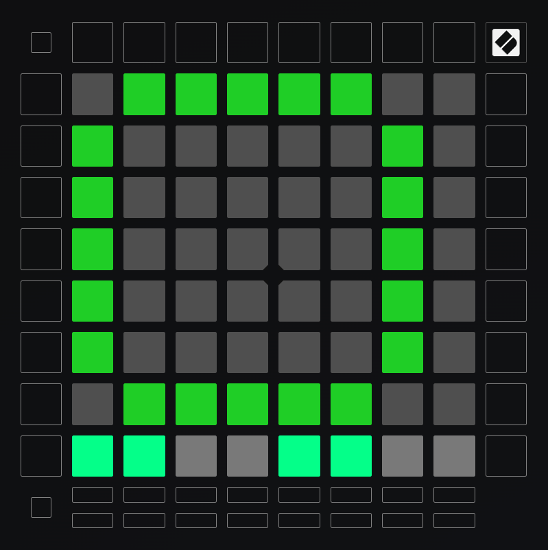
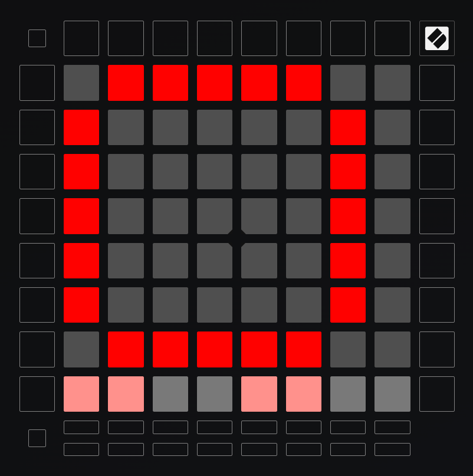
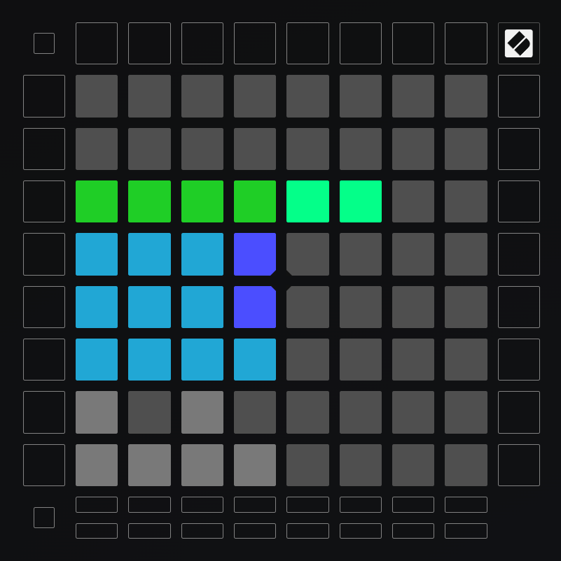

# Launchpad Pro mk3

Sysex files can be uploaded into the launchpad editor at https://components.novationmusic.com/
- New custom mode in the top left
- Upload custom mode

## F16
Three screens, left MFD, right MFD and UFC/ICP.  
Each screen sends MIDI notes on a different channel. LEDs configured to resemble the in-cockpit controls "shape".

### MFD Left (channel 1)

### MFD Right (channel 2)

### ICP (channel 3)

